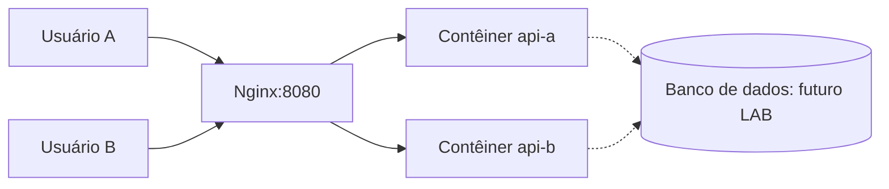

# Jornada Azure & Python — laboratórios de streaming 🎬

> Trilha prática de Docker e balanceamento, usando uma **plataforma fictícia** de streaming. Não é uma reprodução da infraestrutura da Netflix.

## Comece pelo encontro de hoje

1. [Guia da mentoria — 60 minutos](docs/guia-mentoria.md)
2. [Arquitetura com diagramas ilustrados](docs/arquitetura.md)
3. [LAB 01 — Imagem e contêineres](labs/lab-01-docker/README.md)
4. [LAB 02 — Réplicas e balanceamento](labs/lab-02-balanceamento/README.md)
5. [Como preparar o computador](docs/ambiente.md)
6. [Avaliação de Pedro e Ryan](mentoria/avaliacao.md)

## Por que estamos construindo isto?

Imagine duas pessoas consultando o catálogo de um streaming. A plataforma precisa responder às solicitações e continuar funcionando diante de falhas de instâncias. Neste laboratório, **Nginx** distribui requisições entre dois contêineres que executam uma API Python/Flask.



**Atenção:** o usuário não tem um contêiner exclusivo; o balanceamento acontece por requisição. Em plataformas reais, a distribuição do conteúdo de vídeo geralmente envolve CDN. Este laboratório simula **o catálogo**, não o streaming de vídeo.

## Início rápido (Docker + Compose)

Na raiz do repositório, com Docker ativo:

```bash
docker compose up --build -d
docker compose ps
```

Abra **http://localhost:8080**. Atualize a página e observe o campo `Servidor`, que identifica a réplica responsável.

Para desligar e limpar:

```bash
docker compose down
```

**Não é necessário criar conta Azure nem provisionar AKS.**

## Trilha

| Etapa | Tema | Status |
|---|---|---|
| LAB 01 | Docker, imagens e contêineres | Documentado |
| LAB 02 | Réplicas, Nginx e falhas | Documentado |
| LAB 03 | Kubernetes local | Planejado |
| LAB 04 | AKS | Planejado (avaliar custos antes de provisionar) |
| LAB 05 | Persistência e banco de dados | Planejado |
| LAB 06 | Observabilidade | Planejado |
| LAB 07 | CI/CD | Planejado |

## Critério pedagógico

Depois de praticar, cada aluno deve registrar a experiência no portal. **Só liberar a próxima aula** com autoavaliação de **4 ou 5** e explicação própria convincente; caso contrário, revisar.

Este repositório contém apenas um ambiente didático, sem dados pessoais nem configuração Azure.