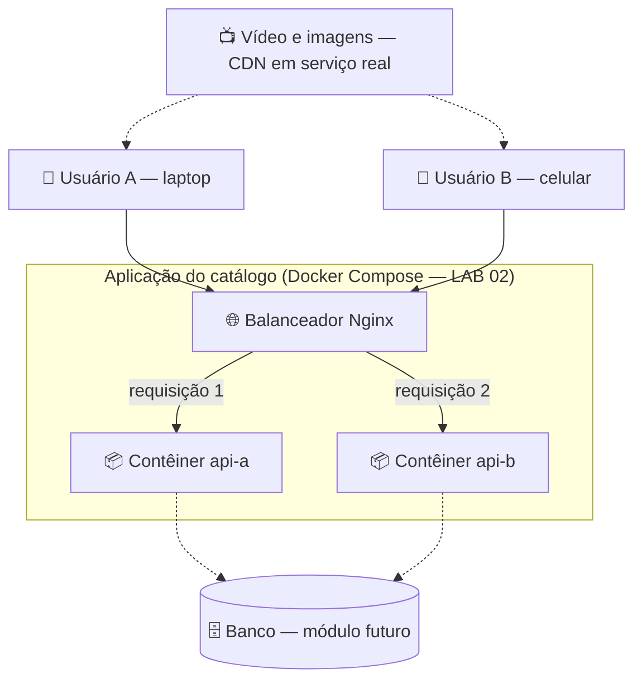
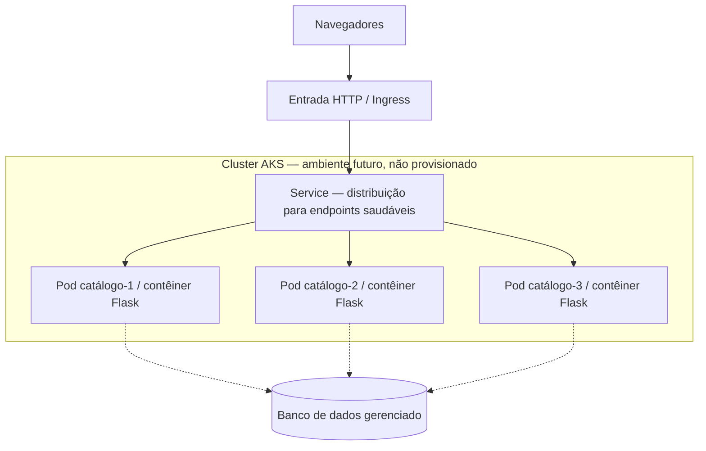

# Arquitetura ilustrada — nosso streaming fictício

## Desenho 1 — duas pessoas, múltiplas requisições

As setas representam **pedidos individuais**. Não significam que o usuário A pertence ao contêiner A. Atualizar o navegador pode produzir respostas de instâncias diferentes. O Docker Compose é o orquestrador **destes laboratórios**, não AKS.

## Desenho 2 — como isso evoluiria para Kubernetes

**Separar os conceitos:** Nginx no LAB 02 é um proxy/balanceador. Kubernetes Service pode distribuir tráfego para Pods, enquanto Ingress ou Gateway oferece entrada HTTP. O AKS administra a plataforma de Kubernetes; não garante por si só zero downtime, ausência de falhas ou custos baixos.

## Cinco perguntas para discutir olhando as figuras

1. O que muda se 10 usuários acessarem em vez de 2?
2. O que aconteceria se tivéssemos apenas uma instância?
3. Uma única pessoa pode ser atendida por Pods diferentes? **Sim, entre requisições.**
4. Qual problema o banco de dados resolve que uma réplica não resolve?
5. Qual parte desta figura enviaria os bytes de um filme longo? **Em uma plataforma de vídeo real, normalmente um caminho de entrega por CDN — não necessariamente os Pods da API.**