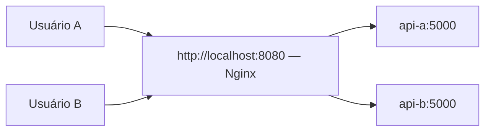

# LAB 02 — Um endereço, duas réplicas e um balanceador

**Objetivo:** compreender por que o cliente não precisa saber qual contêiner respondeu.

## Problema real

Uma plataforma de streaming fictícia atende muitas pessoas. Cada pedido de catálogo pode ser resolvido por uma das réplicas. Queremos usar **uma única URL** em vez de pedir que usuários escolham manualmente as portas 8081 e 8082.

## Arquitetura



**Importante:** o balanceador distribui **requisições**; não reserva um contêiner para cada pessoa. O exemplo usa dois contêineres Flask e Nginx. **Não há AKS** nesta etapa.

## Executar

Na raiz do repositório:

```bash
docker compose up --build -d
docker compose ps
```

Abra **http://localhost:8080**. Observe a indicação **Servidor**.

### Ver a distribuição

Atualize a página várias vezes. A resposta geralmente alterna entre **api-a** e **api-b** (política round-robin padrão do upstream Nginx; conexões e comportamento do navegador podem influenciar a sequência).

Um teste mais previsível é executar no terminal:

```bash
for i in 1 2 3 4 5 6; do curl -s http://localhost:8080/api/status; echo; done
```

O JSON contém `instance`, indicando qual cópia atendeu. No PowerShell, use `1..6 | ForEach-Object { (Invoke-RestMethod http://localhost:8080/api/status).instance }`.

### Simular a falha de uma réplica

```bash
docker compose stop api-a
docker compose ps
```

Aguarde alguns segundos e recarregue **http://localhost:8080**. Com `api-b` funcionando, o Nginx normalmente consegue continuar respondendo ao tentar outro upstream; **algumas requisições podem falhar durante a transição**. Isto não representa garantia de alta disponibilidade.

Restaure:

```bash
docker compose start api-a
```

### Encerrar

```bash
docker compose down
```

## Explique em suas palavras

1. Por que o usuário acessa apenas a porta **8080**?
2. O que o Nginx faz? Ele guarda os filmes no banco de dados?
3. Por que o nome do servidor pode mudar quando você atualiza?
4. O que aconteceu ao parar `api-a`?
5. Se precisarmos de **10 réplicas**, seria conveniente cadastrar todas manualmente? Que problema um orquestrador como Kubernetes ajuda a resolver?

## Exemplos reais

- **E-commerce:** várias instâncias de API para catálogo e carrinho.
- **Sistema bancário:** diferentes instâncias para consultar dados, com controles de segurança e consistência.
- **Streaming:** APIs de catálogo e recomendações escaláveis; vídeos pesados normalmente são distribuídos por CDN.

## Evidência e avaliação

Captura da página, seis respostas da API, resultado após a falha, explicação escrita própria e autoavaliação. Só avançar com nota **4 ou 5** e demonstração convincente de entendimento.